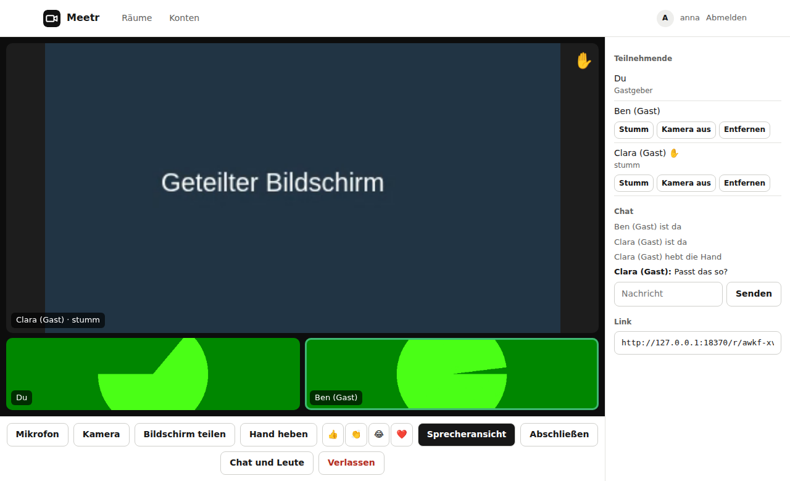

<p align="center"></p>
<h1 align="center">Meetr</h1>
<p align="center">Videokonferenzen im Browser, auf dem eigenen Server.</p>



## Was es kann

| Bereich | Funktionen |
|---|---|
| Räume | per Link, mit Kennwort, mit Termin und Kalenderdatei |
| Gäste | ohne Konto, warten bis zum Einlass |
| Gespräch | Video, Ton, Bildschirm teilen (auch ohne Kamera), Chat, Hand heben, Reaktionen |
| Ansicht | Galerie oder Sprecheransicht, auch am Handy |
| Moderation | stummschalten, Kamera aus, entfernen, Raum abschließen |

## Starten

```bash
cp .env.beispiel .env            # Kennwort für die Datenbank eintragen
docker compose up -d --build
docker compose logs meetr        # Link mit Einrichtungscode
```

Meetr läuft unter `http://<host>:8370`. **Kamera und Mikrofon geben Browser nur
über HTTPS frei** (oder auf localhost), also gehört TLS davor. Das erste Konto
aus dem Link verwaltet die App, bei OIDC trägt man den Admin in `MEETR_ADMIN` ein.

## Wie die Verbindung läuft

Video und Ton gehen per WebRTC direkt zwischen den Teilnehmenden, der Server
vermittelt nur. Er braucht dafür keine UDP-Ports.

* Im selben Netz reicht das ohne weiteres.
* Von außerhalb braucht es einen TURN-Server, einzutragen in `MEETR_ICE`. Dessen
  Zugangsdaten bekommt nur, wer im Raum zugelassen ist.

## Grenzen

* Hinter einem Proxy auf demselben Rechner den Port nur an `127.0.0.1` binden, sonst
  ist die Adresse eines Gastes fälschbar (die Grenze je Raum gilt trotzdem).
* Kein SFU: jeder schickt an jeden, deshalb höchstens 12 Personen, flüssig eher 4 bis 6.
* Keine Aufzeichnung, keine Untertitel, kein Ton beim Bildschirmteilen.
* Ein abgeschlossener Raum öffnet sich, wenn alle gegangen sind.

## Entwickeln

```bash
go test ./...
# mit Datenbank; der Name muss mit pruef beginnen
MEETR_TEST_DB=postgres://.../pruef_meetr go test -p 1 ./...
```

Go 1.27.4, PostgreSQL 17. Lizenz: MIT, siehe [LICENSE](LICENSE).
